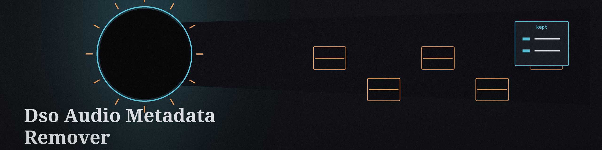

# dso-audio-metadata-remover
Command-line tool to remove metadata from audio files (MP3, WAV, FLAC, etc.) to protect privacy. Utilizes libraries like mutagen to access and remove ID3 tags and other metadata fields. - Focused on Tools for sanitizing and obfuscating sensitive data within text files and structured data formats

## Install
`git clone https://github.com/ShadowStrikeHQ/dso-audio-metadata-remover`

## Usage
`./dso-audio-metadata-remover [params]`

## Parameters
- `-h`: Show help message and exit
- `-o`: Path to the output audio file. If not specified, overwrites the input file.
- `-k`: No description provided
- `-l`: Path to the log file. If not specified, logs to console.

## License
Copyright (c) ShadowStrikeHQ

## Behaviour notes
- For MP3 and FLAC, a separate `-o` output is made by copying the input file to the output path first and then stripping the copy, so the output is a complete audio file and the input is left untouched.
- For WAV, `-o` and `-k` are honoured the same way: the file is copied to the output path and the copy is stripped, keeping any tags named with `-k`. The input is modified in place only when no output path is given.
- A file with no ID3 header prints a plain no metadata found line instead of the completion line. When an output file was requested and none can be produced, the run exits 1.
